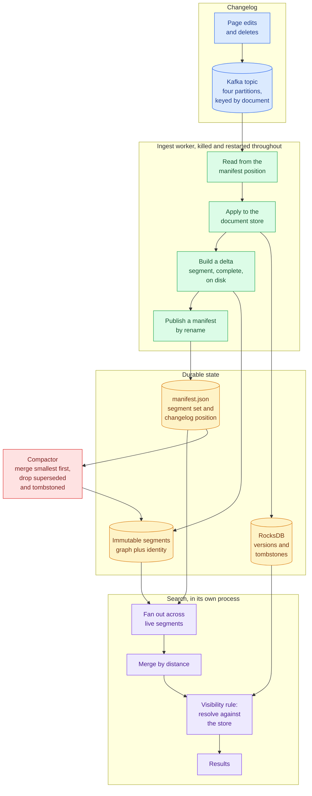
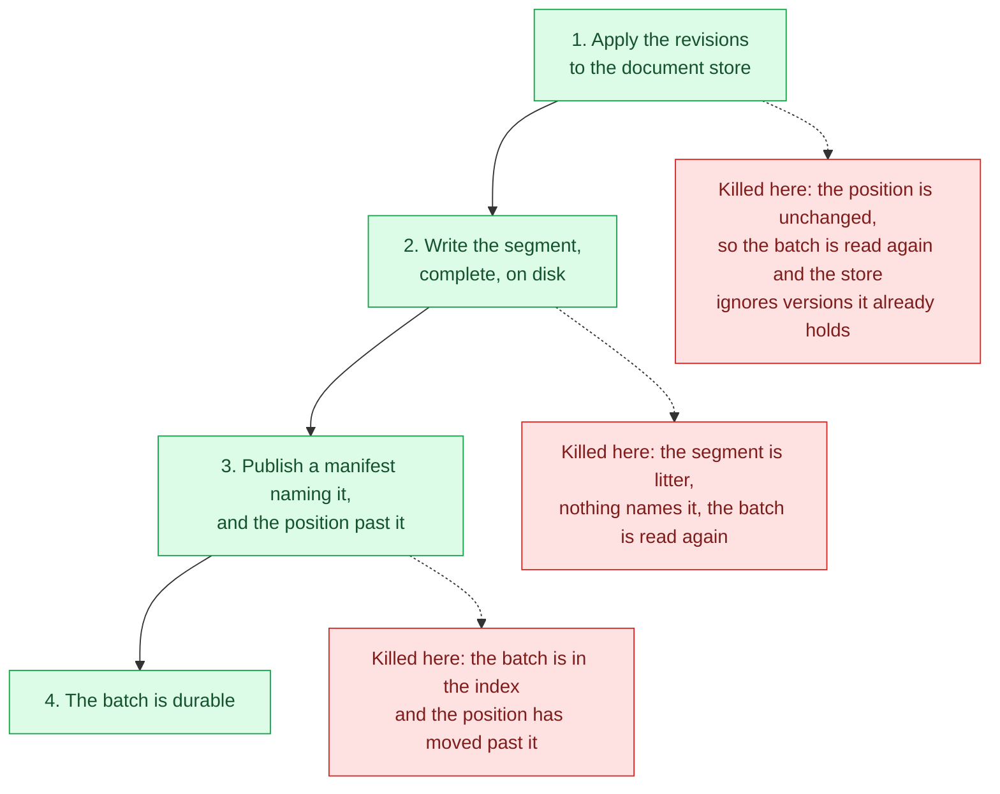

# indexpulse

[](https://github.com/rajeev-chaurasia/indexpulse/actions/workflows/ci.yml)

A search index fed by a changelog, built so that a page being edited, deleted or
re-indexed while the index is being read cannot produce a result showing what
the page used to say.

> A revision that reaches the changelog becomes searchable at its new content,
> or it is not searchable at all. IndexPulse never returns a document version
> that has been superseded or deleted, and never loses a revision, including
> while ingest workers are being killed mid-write and segments are being
> compacted under concurrent reads.

Making a document searchable is the easy half. The half this repository is
about is what happens when writes and reads overlap, which is all the time, and
where a freshness-oriented index usually breaks:

- A delete reaches the document store but not every segment holding a vector
  for that document, so the deleted page keeps coming back.
- A segment set is swapped non-atomically, so a reader sees the old segment and
  the new one at once, and the same document at two versions.
- A worker crashes after writing a segment but before recording how far it
  read, or the reverse, so a revision is applied twice or dropped entirely.

The claim, the thresholds and the negative control were fixed in
[PLAN.md](PLAN.md) and committed before the corpus was collected, which the
history shows.

## How it stays correct

Three decisions carry the whole thing, and each is checked rather than trusted.

**Segments are never edited.** A segment is an HNSW graph plus the document
identity of every vector in it, written once. Edits and deletes do not reach
back into it. That is what makes a segment safe to share between processes with
no locking, and it means the index holds stale vectors by design.

**Stale vectors are filtered at query time, not prevented.** Candidates are
merged across segments by distance, and only the survivors are resolved against
the document store. A hit is served only if its version is the one the store
currently holds and the document is not tombstoned. The whole guarantee lives in
[`core/visibility.py`](src/indexpulse/core/visibility.py), which is thirty lines
and depends on nothing.

**One file records both the segment set and the changelog position.** Kafka will
happily remember how far a consumer group has read, and relying on that gives
two records of the same fact which disagree after a kill: the broker knows what
was delivered, the manifest knows what was made durable. Only the second is
true. So partitions are assigned explicitly, seeks come from the manifest, and
the manifest is published by writing a complete file and renaming it over the
old one.



## Surviving the kill

The ordering inside the worker is the entire crash-safety argument, and every
other arrangement of these steps is wrong:



There is no window in which the recorded position has moved past work the index
does not hold. Nothing catches the signal: a worker that got to tidy up would be
proving something about its shutdown path rather than about the format it leaves
on disk, so the kill is one that cannot be caught.

Replay then has to be harmless, and getting that wrong is subtle. A revision
re-delivered after a kill does not advance the store, because the store already
holds that version. The first smoke run lost twenty two revisions to exactly
that: the worker indexed only what advanced the store, so a revision applied
just before a kill was dropped by the replay that should have rescued it. The
store now reports what is *current* rather than what *advanced*, and the
regression is pinned by a test.

## The negative control

A green test that has never been shown to fail is worth nothing, so the same
corpus, query set and kill schedule run with each defence switched off in turn:

| flag | what it removes | what it should break |
| --- | --- | --- |
| `--unsafe visibility` | the version check before serving a hit | stale and deleted documents come back |
| `--unsafe offsets` | recording the position only after the segment is durable | revisions never reach a segment |
| `--unsafe swap` | atomic rename, and the grace period before deleting retired segments | torn manifest reads, segments read after deletion |

If the unsafe runs do not fail, the audit cannot see the bug class it claims to
rule out, and the safe run's zero means nothing.
[`script/validate_evidence.py`](script/validate_evidence.py) fails the build on
that, not just on the claim.

## How staleness is audited

The visibility rule is not allowed to mark its own work, so the audit shares no
code with the search path. It is given two files the index never touches, the
changelog as published and the hits as served, and recomputes the verdict from
the changelog alone.

A hit is stale if a newer revision of that document entered the changelog more
than the tolerance before the hit was served. The tolerance is twelve seconds,
the same number as the freshness threshold, and it is what makes the claim a
promise rather than a tautology: an index may lag, but it may not still be
serving old content once the lag it is allowed has passed. The strictest
reading, a tolerance of zero, is published alongside it; hits that fail only
there were served while the edit was still in flight, which the claim permits.

## Results

One run of each configuration, on one laptop, against 1,200,000 generated pages
with 180,000 revisions published to the changelog at 300 per second while 100
reader threads queried the index and the ingest worker was killed 60 times.
Every number below is recomputed from the raw records in `evidence/` by
[`script/validate_evidence.py`](script/validate_evidence.py) in CI, so editing a
summary to say something nicer fails the build.

### The claim

| threshold, fixed in PLAN.md before the run | committed | measured | |
| --- | ---: | ---: | --- |
| stale versions served | 0 | **0** | held |
| deleted documents served | 0 | **0** | held |
| revisions lost | 0 | **0** | held |
| hits blocked by the visibility rule | at least 4,000 | **145,687** | held |
| update-to-search freshness, p95 | at most 12 s | **3.80 s** | held |
| vector lookup under compaction, p95 | at most 240 ms | **96 ms** | held |
| injected worker failures survived | 60 | **60** | held |

Measured over 61,864 queries and 618,640 served hits, against 1,178,367 live
documents after deletes.

The strict reading, with the tolerance set to zero, counts 105 superseded and 15
deleted hits. Those were served while the edit was still travelling from the
changelog to the index, which the claim permits and the twelve second tolerance
exists to express. They are published here rather than folded into the headline
count or left out.

### The controls

The zeros above mean nothing on their own, because an audit that cannot detect
staleness reports none on a broken index just as happily. Same corpus, same
queries, same kill schedule, same grading code, one defence removed:

| run | stale served | deleted served | revisions lost | torn manifest reads |
| --- | ---: | ---: | ---: | ---: |
| safe | 0 | 0 | 0 | 0 |
| `--unsafe visibility` | **28,147** | **5,422** | 0 | 0 |
| `--unsafe offsets` | 0 | 0 | **5,434** | 0 |
| `--unsafe swap` | 0 | 0 | 0 | **18** |

Each defence breaks the thing it was put there for, and nothing else. The
visibility rule is the only one holding stale content out of results. Recording
the changelog position before the segment is durable is the only one that loses
revisions. The atomic rename is the only one that keeps a reader from meeting a
half-written manifest.

Removing the atomic swap is the mildest of the three, and the reason is worth
stating: a torn manifest is detected when it is parsed, so the searcher declines
the generation rather than acting on a partial segment list. The cost is an
update the reader does not pick up, not a wrong answer. That is layering working
as intended, and it is also why a run of minutes can miss the race entirely.
`tests/test_manifest.py` pins it independently, reading a manifest continuously
while it is republished: roughly seven thousand torn reads per trial without the
rename, exactly zero with it.

### What it costs

| | p50 | p95 | p99 | max |
| --- | ---: | ---: | ---: | ---: |
| freshness, publish to searchable | 0.81 s | 3.80 s | 5.87 s | 7.93 s |
| lookup, no compaction running | 2.9 ms | 46 ms | 215 ms | 686 ms |
| lookup, during compaction | 6.1 ms | 96 ms | **959 ms** | **2,084 ms** |

The committed threshold was on p95 and it holds with room to spare. The p99
under compaction does not read nearly as well, and it is the number to argue
with: at the ninety-ninth percentile a query during a compaction takes most of a
second, and the worst one took two. A single laptop merging a 1.2 million vector
segment while a hundred threads read it is not a configuration anybody should
run, and the tail says so.

That tail also varies more between runs than the design should allow. The same
measurement in the three control runs gives p99 under compaction of 97 ms,
110 ms and 211 ms, against 959 ms here, on identical settings. The next section
shows the write rate accounts for some of it, and nothing accounts for the rest.
[docs/known-misses.md](docs/known-misses.md) says so rather than averaging it
away.

### A second regime

The run above publishes at 300 revisions per second, which is close to what this
machine will take. A second safe run at 100 per second, over 60,000 revisions
and the same 1.2 million pages, separates what the index does from what the load
does to it:

| | 300 rev/s | 100 rev/s |
| --- | ---: | ---: |
| stale versions served | 0 | 0 |
| revisions lost | 0 | 0 |
| freshness p95 | 3.80 s | 1.92 s |
| freshness max | 7.93 s | 2.92 s |
| lookup under compaction, p99 | 959 ms | 199 ms |
| lookup under compaction, max | 2,084 ms | 319 ms |

The correctness claim is indifferent to the rate, which is the point of it. The
latency tail is not: at a third of the write rate the worst query during a
compaction is 319 ms rather than two seconds. So the tail in the first table is
a statement about a saturated laptop, not about the design.

That does not explain the spread between runs at the *same* rate, which remains
97 ms, 110 ms, 211 ms and 959 ms at p99 across four runs configured identically.
Load explains the difference between the two tables. Nothing here explains the
difference within the first one.

### What went wrong first

The first full run reported a freshness p95 of 86 seconds against a 12 second
threshold, and the obvious explanations were both wrong: compaction accounted
for 8% of the run and worker restarts for 11%. The cause was the measurement.
Probes were queued behind four threads that each waited up to 90 seconds on
probes that could never resolve, and the wait was being charged to the index.
Latency grew with position in the run, from a p50 of 0.77 s in the first quarter
to 84 s in the third, which is a queue filling rather than an index degrading.

Probes now record when they started, anything that waited more than two seconds
for a prober is excluded and counted as `late_start`, and the auditor settles a
timeout the prober could not classify by checking whether the changelog deleted
the page while it watched. The run above has 9 `late_start` probes out of 1,034.
The commit that fixed it names the defect, and this paragraph stays because a
repository that only shows its corrected numbers is hiding the more useful half.

## Running it

```bash
docker compose up -d --wait
uv sync --all-groups
uv run pytest
```

A full measurement, which takes about twenty minutes a run on a laptop:

```bash
./script/collect_evidence.sh
```

A single run at a scale that finishes in under a minute:

```bash
uv run python -m bench --scale smoke
```

## Layout

| path | what is in it |
| --- | --- |
| `src/indexpulse/core/` | revision model, visibility rule, manifest, vectors; standard library, numpy and pydantic only |
| `src/indexpulse/store/` | versioned document state on RocksDB, read by searchers as a secondary |
| `src/indexpulse/index/` | segment format, manifest publishing, compaction |
| `src/indexpulse/search/` | fan-out and the read path |
| `src/indexpulse/ingest/` | changelog client and the worker |
| `bench/` | corpus generator, run harness, auditor |
| `script/` | layer check, prose check, evidence validator |
| `evidence/` | raw records and the summary recomputed from them |

The boundary around `core` is enforced by
[`script/check_layers.py`](script/check_layers.py) in CI. Its value is that the
rule deciding whether a hit may be served can be read and tested without a
broker, a key-value store or a vector index in the way, and that property decays
the first time someone reaches for a convenience from an outer layer.

## What this is not

Vectors are generated from page content by a hash rather than a trained model,
so nothing here says anything about retrieval quality, and no recall number is
published. The failure model is process death, not host power loss. Everything
runs on one machine with one broker. See [docs/non-goals.md](docs/non-goals.md)
for the full list and [docs/known-misses.md](docs/known-misses.md) for the gaps
in the evidence, written against the repository rather than for it.
